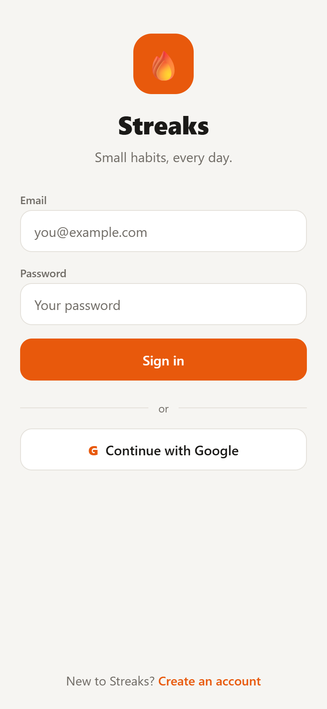
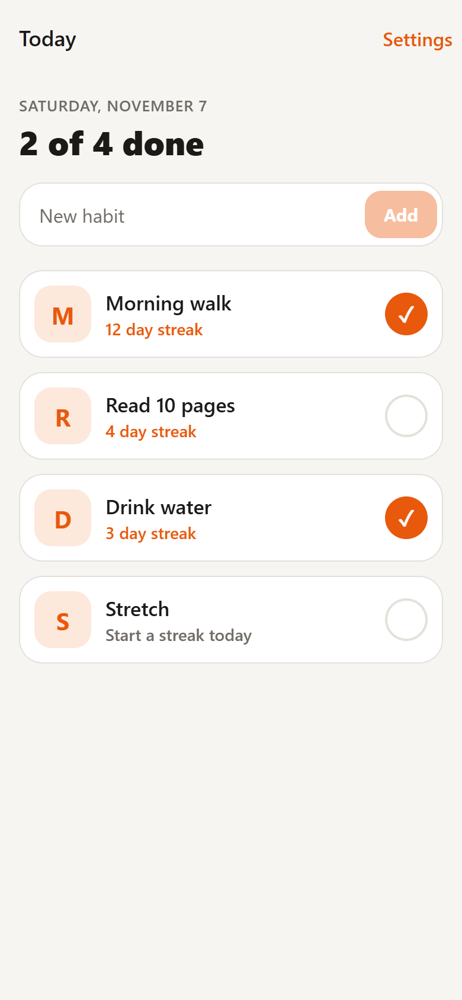
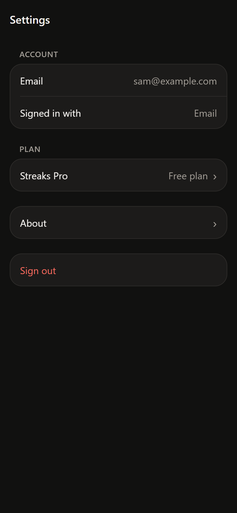

# Streaks: the store-ready sample app

Streaks is a small habit tracker built with Expo SDK 58, TypeScript and Expo Router. It is the sample app for [store-ready](../../README.md): the checker runs against it to show real App Store and Google Play review problems, and the skills fix them.

This copy is the "before" state. It runs, but it has the review gaps a typical weekend app ships with. They are listed in [BEFORE.md](BEFORE.md).

<p>
  
  
  
</p>

## What it does

- Email sign-up and sign-in, plus "Continue with Google".
- A list of habits for today: add a habit, check it off, see the current streak.
- A detail screen per habit with best streak, total check-ins and a photo from the camera or library.
- Settings with sign-out, a "Streaks Pro" row that opens a placeholder paywall (no purchases), and About.
- Light and dark mode.

Habits are stored on the device with AsyncStorage.

## Auth is a local mock

There is no real authentication in this app. `src/auth.ts` creates a mock session on the device: sign-up and sign-in only check that the email looks valid and the password has at least 8 characters, then save a user profile (id, email, provider, created date) in AsyncStorage. The password is never stored or checked, and "Continue with Google" signs in a fixed demo user without contacting Google.

A real app must authenticate against a backend, for example Firebase Auth, Supabase Auth, Clerk or your own server, and use the provider's native SDK for Google and Apple sign-in. Do not copy `src/auth.ts` into a production app.

## Run it

Requires Node 22.13 or newer.

```bash
npm install
npm run web        # open in a browser
npm start          # start the dev server for a device
```

SDK 58 is newer than the current Expo Go release, so on a phone use a [development build](https://docs.expo.dev/develop/development-builds/create-a-build/):

```bash
npx expo install expo-dev-client
npx eas-cli@latest build:configure
npx eas-cli@latest build --profile development --platform android   # or ios
npm start          # then open the project from the installed dev build
```

Native builds run on EAS in the cloud; Xcode and the Android SDK are not needed locally. Once Expo Go supports SDK 58, `npm start` and scanning the QR code with Expo Go also works.

## Checks

```bash
npm test             # jest-expo: streak logic, mock auth, habits screen
npm run typecheck    # tsc --noEmit
npx expo-doctor
npx expo export --platform web
```

## Layout

- `src/app/`: routes (sign-in, sign-up, habits list, habit detail, settings, paywall, about)
- `src/streaks.ts`: streak calculations (pure functions)
- `src/habit-store.ts`, `src/habits-context.tsx`: habit storage and state
- `src/auth.ts`, `src/session.tsx`: mock auth and session state
- `src/photos.ts`: camera and library picking
- `src/components/`: UI pieces
